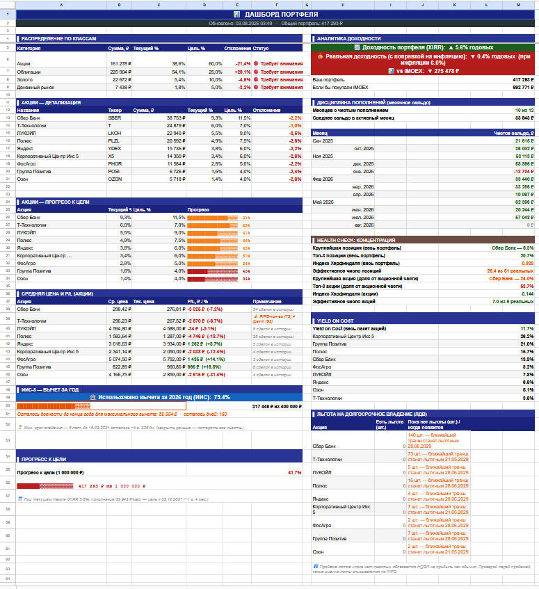
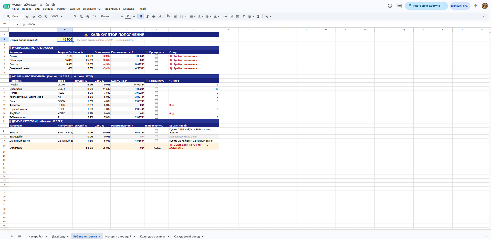
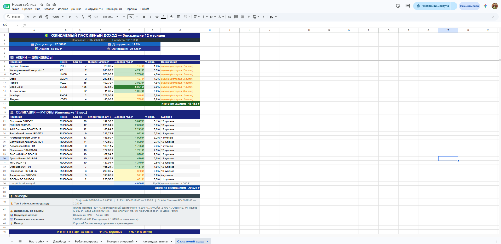
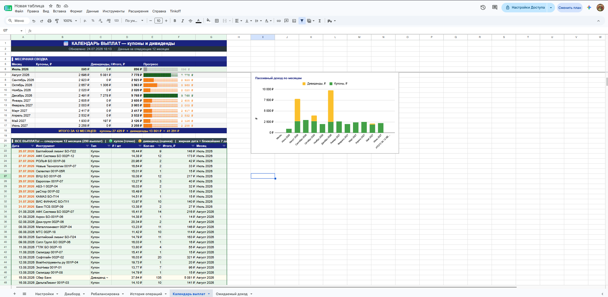
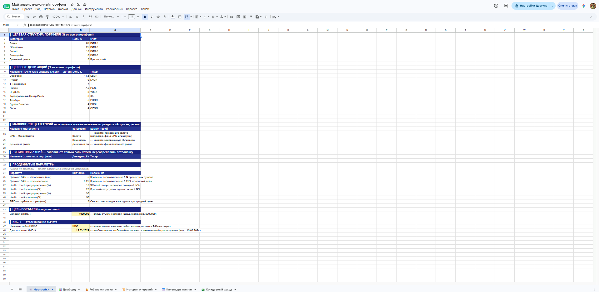
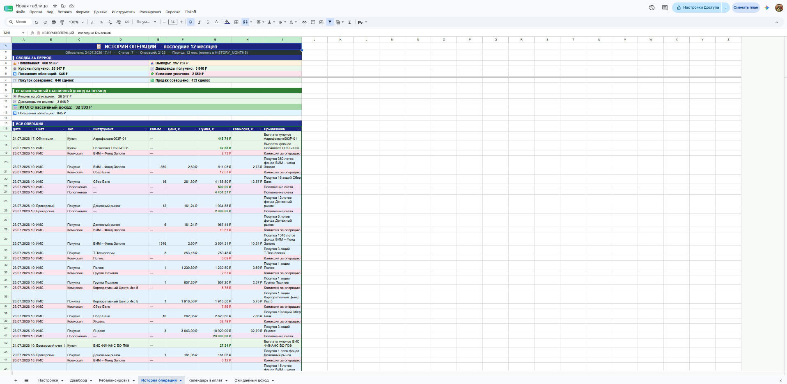
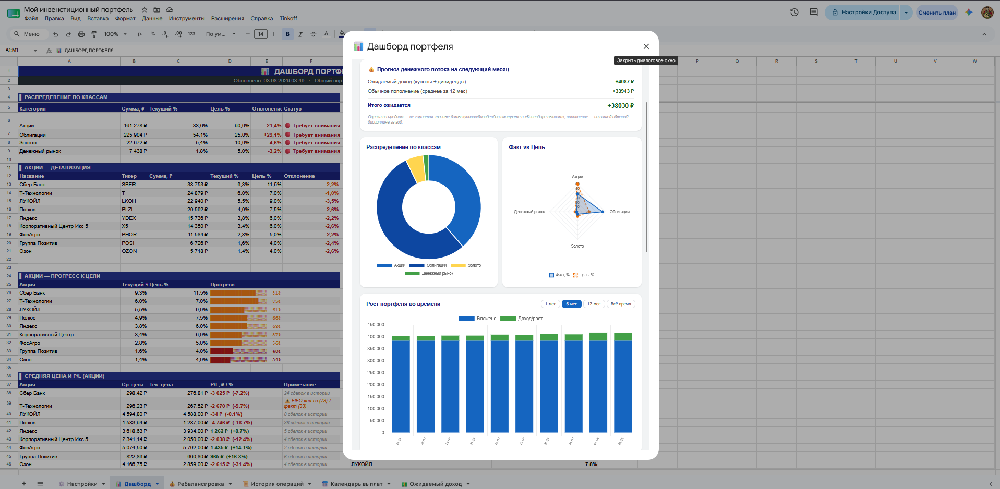

# 📊 T-Invest Portfolio Tracker

> **Умная ребалансировка с учётом лотов. Реализованный пассивный доход. Полноценная история, календарь выплат, health-check и XIRR — всё в одной таблице.**

Работает прямо в **Google Sheets** и синхронизируется через **T-Invest API**: одного токена с правами на чтение достаточно, чтобы подтянуть **ИИС-3** и любые другие счета Т-Банка одновременно.

> 💡 **По умолчанию использует прокси Relferium** — новичкам не нужно бороться с SSL-ошибкой Т-Банка. Если хочешь свой прокси — просто замени одну строку в коде или задай `PROXY_URL` в Script Properties.

> 💭 **Почему не просто ещё один трекер.** Платные сервисы обычно нейтральны к тому, как вы себя ведёте — они просто показывают портфель, независимо от вашей стратегии. Этот инструмент устроен иначе: он структурно подталкивает к долгосрочному поведению, а не просто позволяет его выбрать. «Дисциплина пополнений» отслеживает паттерн за 12 месяцев, а не разовую сделку. Health-check концентрации ловит момент, когда хочется докупить любимую акцию ещё раз. ИИС-3 с его обязательным сроком владения — не «ещё один тип счёта», а полноценный модуль. XIRR считает доходность с учётом времени, а не сиюминутный результат, который провоцирует азарт.

---

## 🖼 Скриншоты

**Дашборд** — распределение портфеля, диаграммы, прогресс к цели, аналитика доходности, health-check

**Ребалансировка** — калькулятор пополнения с умным распределением по лотам

**Ожидаемый доход** — купоны и дивиденды на ближайшие 12 месяцев

**Календарь выплат** — точные даты и суммы по месяцам

**Настройки** — целевая структура портфеля и вся стратегия

**История операций** — все сделки за 12 месяцев и реализованный пассивный доход

**HTML-дашборд** — интерактивные графики Chart.js

📖 Полный пошаговый гайд по установке — в [`INSTALLATION.md`](INSTALLATION.md).

---

## ✨ Возможности

### 💰 Умная ребалансировка с учётом лотов
Алгоритм распределяет бюджет пропорционально дефициту каждой позиции, округляет до целых лотов и отдаёт остаток самым отстающим бумагам — пока каждый рубль не найдёт своё место. Кнопка «Пропустить» исключает любую бумагу из расчёта одним кликом.

### 💵 Учёт наличных и денежных активов вне брокера
Отдельный журнал для USD, EUR, вкладов и других денежных активов. Автоматическая сводка с P/L, средним курсом и реализованным доходом. Не влияет на расчёт XIRR инвестиционного портфеля.

### 🏦 Честный учёт пассивного дохода
Купоны и дивиденды считаются отдельно от возврата номинала при погашении облигаций. Дивиденды по умолчанию считаются по **CAGR-прогнозу**: если история выплат за 2+ полных календарных года есть — темп роста дивиденда экстраполируется на следующий год. Плюс **Payout Ratio** по каждой дивидендной акции со светофором 🟢/🟡/🔴.

### 📅 Точный календарь купонных выплат
Расписание купонов подтягивается через `GetBondCoupons` с точными датами. Ближайшие 7 дней выделяются жёлтым.

### 📋 Полноценная история операций
Все операции за 12 месяцев загружаются через `GetOperationsByCursor` с поддержкой пагинации. Автоматически показывает сводку: пополнения, выводы, комиссии и реализованный пассивный доход за период.

### 📈 XIRR, реальная доходность и сравнение с IMOEX
Доходность считается с учётом реальных дат и сумм пополнений (XIRR). Можно задать дату начала расчёта. Плюс **реальная доходность** с поправкой на инфляцию и сравнение с IMOEX.

### 🩺 Health-check концентрации и индекс Херфиндаля
Показывает долю крупнейшей позиции и топ-3 позиций. Плюс индекс Херфиндаля (HHI) и «эффективное число позиций».

### 🏦 Дисциплина пополнений
Месячное сальдо пополнений за последние 12 месяцев.

### 🎯 Прогресс к цели с прогнозом даты
Прогресс к заданной целевой сумме портфеля плюс прогноз даты достижения.

### 🏦 ИИС-3 — вычет, дедлайн и срок владения
Отслеживание использования годового лимита налогового вычета (400 000 ₽) и минимального срока владения счётом.

### 📄 Годовой отчёт и HTML-дашборд одной кнопкой
Полноценный Google-документ с итогами за год и интерактивный HTML-дашборд с графиками Chart.js.

### 🔗 Все счета в одном месте
ИИС-3, брокерские и любые другие открытые счета в Т-Банке подтягиваются автоматически.

### 🤖 Telegram-бот с полноценным меню
Меню 2×2: **💰 Ребаланс**, **📊 Статус**, **🏦 ИИС-3**, **⚠️ Концентрация**. Команды `/status`, `/iis`, `/health`, `/pl <тикер>`.

### 📆 Учёт льготы на долгосрочное владение (ЛДВ)
Отслеживает дату покупки каждого отдельного лота (FIFO) и показывает, сколько акций уже прошли трёхлетний порог владения.

### 📋 История ребалансировок и секторная диверсификация
Каждый расчёт калькулятора пополнения тихо логируется. Отдельно — разбивка акций по отраслям.

### ⚡ Полностью автоматический
Триггеры Google Apps Script: полная синхронизация раз в сутки, ежедневный снимок баланса для истории XIRR и Max Drawdown.

---

## 🚀 Быстрый старт

1. Скопируй таблицу
2. В Apps Script задай `TINKOFF_TOKEN` (токен только на чтение)
3. Запусти `Tinkoff → 🔄 Синхронизировать позиции`

Прокси уже встроен — дополнительно ничего настраивать не нужно.

---

## 📝 Лицензия

MIT

Студия **Relferium** · [relferium.ru](https://relferium.ru)
